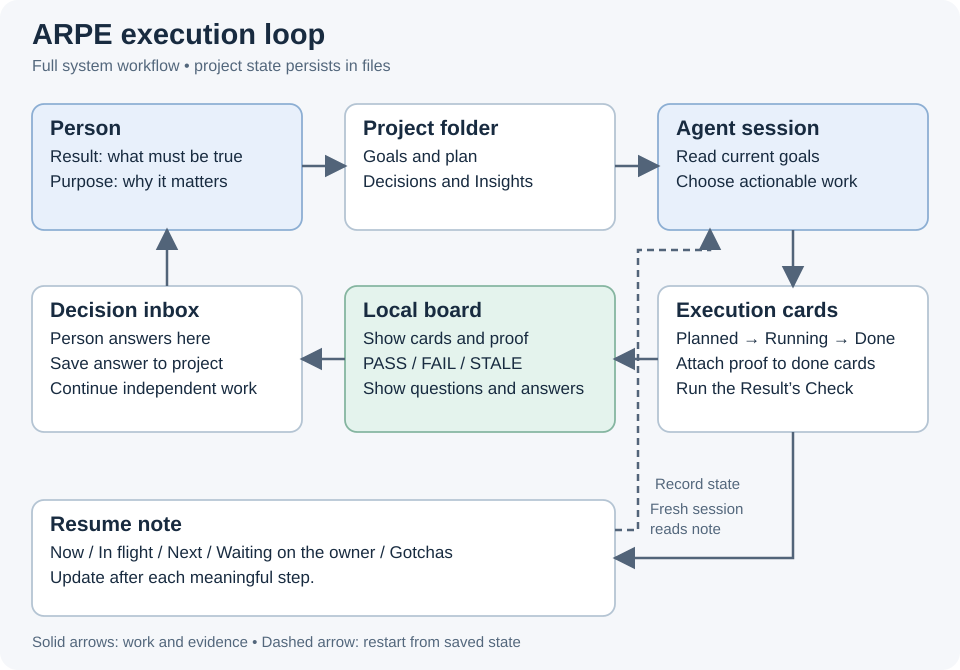
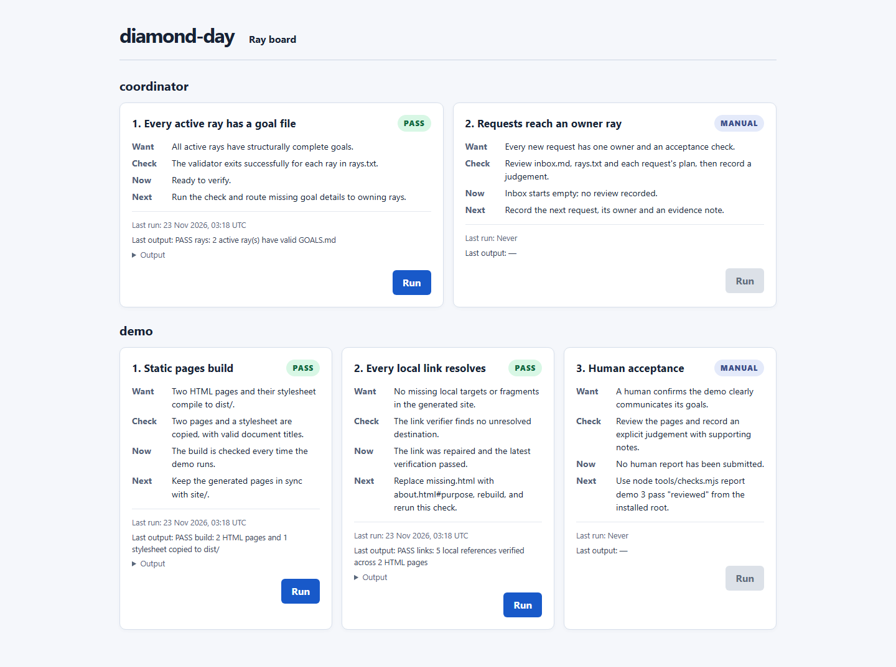

# ARPE

[Start here](docs/GUIDE.md) — install ARPE, reproduce the countdown example, and start your own project.

Give AI agents measurable Results, a Purpose and a project folder that lets them pick up work after a session ends.

Agents get lost as their conversations grow. The original goal and the last useful action can become difficult to recover from a long sequence of messages. A fresh session starts without that conversation.

An agent can keep reporting work while the Result stays unchanged. In the countdown demo, cards were marked done without proof even though a browser test had passed. The owner had to ask what had happened.

An agent can also ask a question in chat and wait while useful work remains. Repeated wakes can produce the same waiting report when a running card never ends.

ARPE stands for **Agentic Result-oriented Purpose-driven Execution**. The person defines the Result (what must be true) and Purpose (why it matters). Agents own Execution: planned, running and done cards, with a proof line under each done card and a Check for each Result. A current resume note lets a fresh session reconstruct the work from files. The local board brings the projects, cards and recorded evidence together.



[Why agents get lost, and the structure that keeps them working](docs/why-agents-get-lost.md) follows the recorded countdown project and explains the full system. This public kit provides the folder structure, local board, check tools and manual handoff workflow. Create a project with `arpe new`, then start its agent with `arpe open`.

The RPM board uses Bun (installed automatically if missing) and no package dependencies. A shell is needed for installation (Bash on Linux/macOS, PowerShell on Windows). The original static-site tutorial below uses Node.js 20+. An AI account is **not** needed to try either demo.


**[Watch the recorded install](docs/tutorial/README.md)**: a real install on Windows, step by step, with screenshots and a [video](docs/tutorial/tutorial.mp4).

## The board

From an extracted checkout, run one command on Linux (Bash, curl and unzip available):

```sh
bash install.sh
```

On Windows (PowerShell 5.1+ or 7+):

```powershell
powershell -NoProfile -ExecutionPolicy Bypass -File .\install.ps1
```

The installer finds Bun or downloads it from the official distribution, creates `~/rays/demo`, and starts one local RPM board on `http://localhost:5195/board`. It adds `arpe` to your user PATH. On Linux open a new login shell or run `source ~/.profile`; on Windows open a new terminal to pick up the user PATH. Open the printed URL; no Claude account, Git, npm or AutoHotkey is needed to see the board. The download needs internet access. The plain detached background process writes `~/.arpe/board.log`; `arpe board` and `arpe restore` restart it if needed. It does not register a system-wide daemon or a boot-time task.

<!-- Screenshot placeholder: docs/img/rpm-board.png (capture the project list and a project page from a clean install). -->

```sh
arpe new demo2 "A small demo"
arpe list
arpe board demo2
bun ~/rays/tools/rpm-check.ts ~/rays/demo2
```

The generated GOALS.md includes Ultimate Vision, Ultimate Purpose, Roles, a current weekly review, and a measurable first Result with Purpose, three chunks, a must, leverage/durations, a runnable file-age Check and Now. The separate RPM checker validates plan structure; the board executes declared outcome checks on startup and every ten minutes, with a one-minute scheduler scan. Open any card’s Check tab for the last verdict, output, declaration and Run control. Update the review weekly. The managed board uses the owner’s dark projects list and three-column RPM plan, with Result, Purpose and Plan, a decision inbox with Dismiss, document navigation, Notes/Plans/Changes tabs, clamped local transcript chat, and stats. Edit the underlying Markdown; the board polls for changes. The portable board saves chat messages as notes; it does not install a private live-session messaging hook, fleet ledger or autonomous agent execution. `arpe open NAME` opens the project board and runs Claude Code in your terminal (install and sign in to the agent separately). `arpe stop NAME` stops a session started by `arpe open` and removes it from the active list, without stopping the shared board. `arpe restore` restarts the board and reopens active rays in Windows Terminal or a graphical Linux terminal when available; otherwise it prints the commands to resume them. `RAY_TERMINAL_BIN` and `RAY_TERMINAL_ARGS` (a JSON array of arguments before the launched command) override terminal discovery; `RAY_RESTORE_MANUAL=1` requests instructions only. Browser and desktop placement are optional. No Claude trust settings are changed.

Configuration: `RAYS_ROOT` (default `~/rays`), `RAY_BOARD_PORT` (default 5195), or installer `--root PATH` / `--port PORT` (`-Root` / `-Port` on Windows). These are saved at installation, not interpreted independently by the service. `--ray NAME` adds additional projects; `--agent` selects Claude Code, Codex or Claude Desktop. `RAY_AGENT_BIN` overrides the agent executable, `RAY_BROWSER_BIN` overrides the system browser opener, `RAY_NO_BROWSER=1` disables opening a window. On Windows `RAY_AUTOHOTKEY_BIN` and `RAY_WINDOW_SCRIPT` can opt into a local placement script; both must exist and neither is required. The script receives the ray name and URL. For offline development only, explicitly set `RAY_RUNTIME=node` with Node.js 22.13+; the default always uses Bun and reports a failed download rather than silently switching.

Uninstall while no managed agent session is running:

```sh
bash install.sh --uninstall
# To also delete the project tree created by this installer, explicitly opt in:
bash install.sh --uninstall --purge
```

```powershell
.\install.ps1 -Uninstall
# To delete an installer-created project tree instead:
.\install.ps1 -Uninstall -Purge
```

Uninstall removes the background board, managed runtime, CLI and managed PATH entry. By default it preserves all project files. **Purge permanently deletes the entire installer-created project root**, including work added after installation; it refuses a root that existed before the first install. Run purge instead of ordinary uninstall if you want a fully empty fresh HOME. An externally installed Bun is not removed. See [portability notes](board/PORTABILITY.md) for the removed machine-specific dependencies and [verification](board/VERIFICATION.md) for the test results.

### Share a project

Run `arpe share start 5196` to start the separate loopback guest listener, then `arpe share demo Guest viewer 24` to create a one-day invitation. For remote access, configure Tailscale Serve and pass its HTTPS origin to `arpe share start 5196 HTTPS_ORIGIN`. The owner board's **sharing** page manages members, roles and published files. `arpe share stop` disables the listener. See [Share a project with one person](docs/GUIDE.md#share-a-project-with-one-person) for the full setup, access boundary and revocation. Never expose the owner board port.

Stats and chat use local records; optional prompt-proxy usage is hidden without configured data. Notes are durable files. See the Guide for settings and `arpe note`.

## Original static-site demo in under five minutes

From a checkout or extracted repository archive, on macOS/Linux:

```sh
bash install.sh --legacy --root "./my-rays" --demo
cd my-rays
node tools/checks.mjs run
node tools/checks.mjs status
node tools/board.mjs serve .
```

On Windows PowerShell:

```powershell
.\install.ps1 -Legacy -Root '.\my-rays' -Demo
Set-Location '.\my-rays'
node tools/checks.mjs run
node tools/checks.mjs status
node tools/board.mjs serve .
```

Open the localhost URL printed by the board. The demo initially shows **PASS** for the real static-site build, **FAIL** for an intentionally broken local link, and **MANUAL** for a review requiring human judgement. The coordinator's structural check is also runnable; no claims depend on fabricated checks. The board has an accessible Run button for every automated goal, the last run time, the last line of output, and an expandable output tail.


Repair the broken link yourself. In `my-rays/demo/site/index.html`, replace `href="missing.html"` with `href="about.html#purpose"`. Then run these commands **from the `my-rays` root**:

```sh
node tools/checks.mjs run demo 1 --force
node tools/checks.mjs run demo 2 --force
node tools/checks.mjs status
```

Refresh the browser: the links goal is now **PASS**. The `--force` flag overrides the ten-minute check cooldown for a deliberate CLI repair/recheck. The board's Run button does not bypass cooldown.



The legacy walkthrough screenshots above are captured from a fresh, independently installed demo using real Chrome/Edge/Chromium and the Chrome DevTools Protocol. To reproduce both PNGs, with a locally installed browser:

```sh
node tools/screenshots.mjs
```

Set `CHROME_PATH` to a browser executable if automatic discovery fails. The capture script uses no Puppeteer, doesn't fake colors, starts its own loopback board, fixes the link in a disposable demo, and writes `docs/img/board-failing.png` and `docs/img/board-repaired.png`. It fails with a clear error if no browser can be found.

## Review every agent reply before applying it

`diamond` turns agent ZIPs or folders into `reply/<job>` branches based on the target
repository's current `HEAD`, with a per-reply `DIFF.md` review page, one index,
and explicit merge/skip decisions. It never checks out the branch or modifies
your working tree during a scan. See the [install-free guide and offline
walkthrough](guides/diamond.md) for usage, scheduler checks, and the demo inbox.

Claude Code can automatically surface waiting replies on session start and after each turn with the [Diamond plugin](guides/diamond-plugin.md), including review and reasoned merge/skip commands.

## The daily goal loop

Each goal records **Want** (outcome), **Check** (prose criterion plus explicit `check:` declaration), **Now** (evidence), and **Next** (action). A ray keeps restart context in `plans/resume.md`; notes and handoffs live in its own folders. On each restart read the goals and resume file, run the declared checks, fix failures, advance Next, and record proof. No `GOALS.md` prose or text in backticks is executed merely because it mentions a command.

Portable grammar:

```text
  check: run node checks/build.mjs timeout=15s
  check: http GET http://localhost:5195/board 200
  check: file docs/report.md younger 6h
  check: manual
```

For manual checks, record an explicit verdict from the installed root:

```sh
node tools/checks.mjs report demo 3 pass "Reviewed the built pages"
```

The full grammar, safety limits, stale rule and cooldown are in [guides/checks.md](guides/checks.md). Reports and automatic results persist locally under `.arpe/checks-history.json` in the installed root, not in the public repository. PASS/FAIL results become STALE after 24 hours; MANUAL means no judgement yet; NEVER means no recorded run or no valid declaration. The service keeps 50 results per goal and limits concurrent runs to two.

## Use this in a real ray

For the original Node workflow, use `--legacy --ray website --ray notes` (or `-Legacy -Ray` on PowerShell). Each legacy install creates `rays.txt`, `templates/`, `tools/`, a coordinator ray and a per-agent rules file. All installers preserve existing files; they never overwrite an existing goal. `--agent codex` or `--agent claude-desktop` selects the appropriate instruction file. For example, from `my-rays/website`, an agent can read `GOALS.md` and `plans/resume.md`, invoke `node ../tools/checks.mjs run website`, and address failures. Replace the starter `check: manual` only when a truthful verifier exists.

`node tools/board.mjs serve .` is the live board, listening only on the local machine. It serves `/board` and `/api/board` and accepts same-origin POSTs to run declared checks; it is **not a remote execution service**. `node tools/board.mjs .` still creates a read-only offline snapshot `board.html`, for the old workflow and tests. The board schedules declared checks automatically no more than once per ten minutes, and the explicit button respects the same limit.

This is a filesystem workflow and local validation service, not an autonomous agent restarter. The host agent needs a human start or a separately configured supervisor.

## Verification

Run these from the public repository root:

```sh
node --test test/
bash test/clean-install.sh
bash test/no-private.sh
bash test/no-private-regression.sh
```

On Windows, use `pwsh -NoProfile -File test/clean-install.ps1`, `test/no-private.ps1`, and `test/no-private-regression.ps1`. CI runs the install, demo, Node tests, disclosure scans and real browser capture on Windows, macOS and Linux, then uploads screenshots as artifacts.

Agent guides: [Claude Code](guides/claude-code.md), [Codex](guides/codex.md), [Claude Desktop](guides/claude-desktop.md). Other workflows: [coordinator](guides/coordinator.md), [handoffs](guides/handoffs.md), [board and notes](guides/board-and-viewer.md).

### Managed board captures

After a clean managed install, run `node tools/capture-managed-board.mjs http://localhost:5195` to produce `docs/img/kit-home.png`, `kit-project.png` and `kit-card-check.png`. The existing legacy walkthrough images above are not captures of the managed board.
