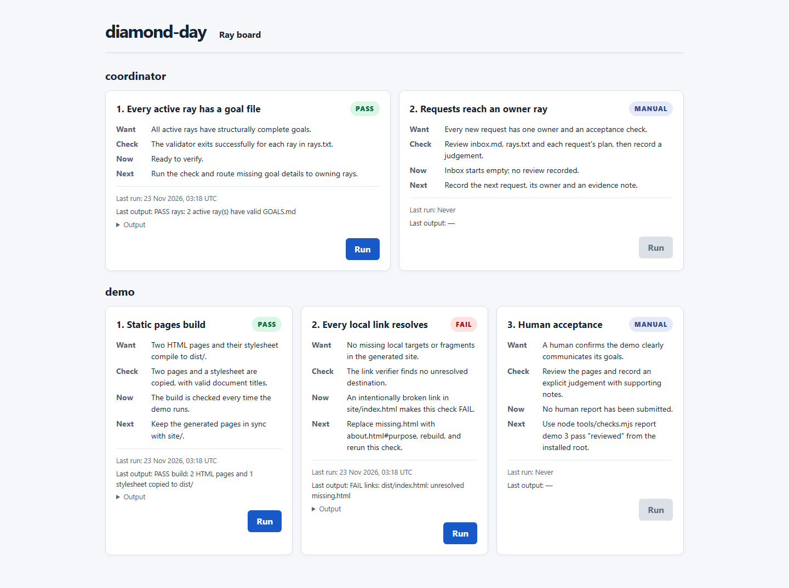

# diamond-day

A public, folder-based way to keep AI coding sessions working toward outcomes. Each **ray** is a folder with `GOALS.md`; each goal has a readable acceptance criterion and a **runnable check or explicit manual judgement**. The local board shows recorded proof, not inferred status.

Requires Node.js 20+ and no npm dependencies. A shell is needed only for installation (Bash on macOS/Linux, PowerShell on Windows). An AI account is **not** needed to try the demo.

## A working demo in under five minutes

From a checkout or extracted repository archive, on macOS/Linux:

```sh
bash install.sh --root "./my-rays" --demo
cd my-rays
node tools/checks.mjs run
node tools/checks.mjs status
node tools/board.mjs serve .
```

On Windows PowerShell:

```powershell
.\install.ps1 -Root '.\my-rays' -Demo
Set-Location '.\my-rays'
node tools/checks.mjs run
node tools/checks.mjs status
node tools/board.mjs serve .
```

Open the localhost URL printed by the board. The demo initially shows **PASS** for the real static-site build, **FAIL** for an intentionally broken local link, and **MANUAL** for a review requiring human judgement. The coordinator's structural check is also runnable; no claims depend on fabricated checks. The board has an accessible Run button for every automated goal, the last run time, the last line of output, and an expandable output tail.



Repair the broken link yourself. In `my-rays/demo/site/index.html`, replace `href="missing.html"` with `href="about.html#purpose"`. Then run these commands **from the `my-rays` root**:

```sh
node tools/checks.mjs run demo 1 --force
node tools/checks.mjs run demo 2 --force
node tools/checks.mjs status
```

Refresh the browser: the links goal is now **PASS**. The `--force` flag overrides the ten-minute check cooldown for a deliberate CLI repair/recheck. The board's Run button does not bypass cooldown.


The screenshots above are captured from a fresh, independently installed demo using real Chrome/Edge/Chromium and the Chrome DevTools Protocol. To reproduce both PNGs, with a locally installed browser:

```sh
node tools/screenshots.mjs
```

Set `CHROME_PATH` to a browser executable if automatic discovery fails. The capture script uses no Puppeteer, doesn't fake colors, starts its own loopback board, fixes the link in a disposable demo, and writes `docs/img/board-failing.png` and `docs/img/board-repaired.png`. It fails with a clear error if no browser can be found.

## The daily goal loop

Each goal records **Want** (outcome), **Check** (prose criterion plus explicit `check:` declaration), **Now** (evidence), and **Next** (action). A ray keeps restart context in `plans/resume.md`; notes and handoffs live in its own folders. On each restart read the goals and resume file, run the declared checks, fix failures, advance Next, and record proof. No `GOALS.md` prose or text in backticks is executed merely because it mentions a command.

Portable grammar:

```text
  check: run node checks/build.mjs timeout=15s
  check: http GET http://localhost:5195/board 200
  check: file docs/report.md younger 6h
  check: manual
```

For manual checks, record an explicit verdict from the installed root:

```sh
node tools/checks.mjs report demo 3 pass "Reviewed the built pages"
```

The full grammar, safety limits, stale rule and cooldown are in [guides/checks.md](guides/checks.md). Reports and automatic results persist locally under `.diamond-day/checks-history.json` in the installed root, not in the public repository. PASS/FAIL results become STALE after 24 hours; MANUAL means no judgement yet; NEVER means no recorded run or no valid declaration. The service keeps 50 results per goal and limits concurrent runs to two.

## Use this in a real ray

Install as many rays as needed: `--ray website --ray notes` (or `-Ray` on PowerShell). Each install creates `rays.txt`, `templates/`, `tools/`, a coordinator ray and a per-agent rules file. All installers preserve existing files; they never overwrite an existing goal. `--agent codex` or `--agent claude-desktop` selects the appropriate instruction file. For example, from `my-rays/website`, an agent can read `GOALS.md` and `plans/resume.md`, invoke `node ../tools/checks.mjs run website`, and address failures. Replace the starter `check: manual` only when a truthful verifier exists.

`node tools/board.mjs serve .` is the live board, listening only on the local machine. It serves `/board` and `/api/board` and accepts same-origin POSTs to run declared checks; it is **not a remote execution service**. `node tools/board.mjs .` still creates a read-only offline snapshot `board.html`, for the old workflow and tests. The board schedules declared checks automatically no more than once per ten minutes, and the explicit button respects the same limit.

This is a filesystem workflow and local validation service, not an autonomous agent restarter. The host agent needs a human start or a separately configured supervisor.

## Verification

Run these from the public repository root:

```sh
node --test test/
bash test/clean-install.sh
bash test/no-private.sh
bash test/no-private-regression.sh
```

On Windows, use `pwsh -NoProfile -File test/clean-install.ps1`, `test/no-private.ps1`, and `test/no-private-regression.ps1`. CI runs the install, demo, Node tests, disclosure scans and real browser capture on Windows, macOS and Linux, then uploads screenshots as artifacts.

Agent guides: [Claude Code](guides/claude-code.md), [Codex](guides/codex.md), [Claude Desktop](guides/claude-desktop.md). Other workflows: [coordinator](guides/coordinator.md), [handoffs](guides/handoffs.md), [board and notes](guides/board-and-viewer.md).
