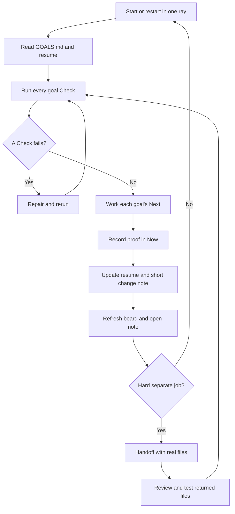

# diamond-day

A folder-based way to keep AI coding sessions working toward goals over days. A **ray** is one folder and one agent session. It is organized around outcomes, not a list of commands that gets stale. The agent can restart from files without depending on old chat context.

Works with Claude Code, Codex CLI, or Claude Desktop. Requires Node.js 18+ for the included checks and local board. Git and the agent itself are separate installs. No account, hosted service, proxy, or other repository is needed for the demo.

## Start in about a minute

From this repository, on macOS, Linux, or Windows with Bash:

```sh
bash install.sh --agent claude-code --root ./my-rays --ray website --demo
cd my-rays/demo
node ../tools/check-goals GOALS.md
node checks/build.mjs
node checks/links.mjs
node ../tools/board ..
```

PowerShell on Windows:

```powershell
.\install.ps1 -Agent claude-code -Root .\my-rays -Ray website -Demo
Set-Location .\my-rays\demo
node ..\tools\check-goals GOALS.md
node checks\build.mjs
node checks\links.mjs
node ..\tools\board ..
```

The demo builds a two-page static site and checks every local link. Open `my-rays/board.html` for the local, read-only ray board. To start an actual agent, open a terminal *in* `my-rays/demo` and run `claude`, then tell it: "Read GOALS.md and plans/resume.md. Run every Check, repair failures, then work on Next." For Codex, use `--agent codex` and run `codex`. For Claude Desktop, use `--agent claude-desktop` and follow [its Project setup](guides/claude-desktop.md). The demo and all the scripts run without an AI account.

## The loop



Each goal in `GOALS.md` says **Want** (outcome), **Check** (repeatable proof), **Research** (where its evidence lives), **Now** (current evidence), and **Next** (the next action). On every start, execute *all* checks, fix failures first, then advance each goal. The checker validates the goal format; it does **not** execute a Check. The ray must run its actual commands.

Keep one `plans/resume.md` current after each meaningful step: Now, In flight, Next, Waiting on the human, and Gotchas. Decisions go in `decisions/`. Short, readable result notes go in `docs/changes/`. Nothing important should exist only in the chat.

## A day with two rays

The website ray starts, runs the build and link checks, fixes a broken link, and records the successful commands under Now. It writes a short note with the change and proof, opens it for the human, and refreshes the board. A longer redesign gets a file-based handoff to another model; the ray checks that result before applying it. Meanwhile, the coordinator ray checks that every active ray has a readable goal file and routes the next request to the right folder. Later, a fresh website session reads the files and repeats the checks.

## What gets installed

The install scripts create a root with `rays.txt`, `templates/`, `tools/`, an automatic `coordinator/` ray, and each requested ray. Each ray gets `GOALS.md`, `README.md`, `plans/resume.md`, and one agent instruction file. They create missing files and directories only; an existing file is never replaced. New ray names are appended to `rays.txt` without erasing other entries. Use `--demo` / `-Demo` to add the independently testable demo. Use repeated `--ray NAME` / `-Ray NAME` for more than one ray.

| Part | Needed? | Where it fits |
| --- | --- | --- |
| Goal files, checks, resume, coordinator | Core | Included in each installed root |
| Plain notes and local HTML board | Core | `tools/open-note`, `tools/board`; board is a generated snapshot, not live monitoring |
| External document viewer | Optional | Replace the OS note opener after writing a change note |
| External live board/restarter | Optional | Read `rays.txt`, goals, notes, and handoff statuses; must be configured separately |
| Model-traffic proxy | Optional | Configure the agent's supported networking settings outside this repository |
| File-handoff bridge | Optional | Ship a handoff brief and attachments, receive files, review and test locally |

The optional integration points are described together in [board and viewer](guides/board-and-viewer.md) and [proxy and bridge](guides/proxy-and-bridge.md). No private tools or unpublished URLs are required.

## Use a real ray

Replace the starter Check (`node ../tools/check-goals GOALS.md`) with a command that proves the **actual** outcome, then run it. Put active ray names one per line in `rays.txt`. Put repository paths you authorize in that ray's `README.md`; an agent should not edit unrelated repositories. The root board can be regenerated with `node tools/board .` from the rays root. It reflects written **Now** values, not live validation.

Agent guides: [Claude Code](guides/claude-code.md), [Codex CLI](guides/codex.md), [Claude Desktop](guides/claude-desktop.md). See [coordinator](guides/coordinator.md), [handoffs](guides/handoffs.md), and [contributing](CONTRIBUTING.md).

This is a workspace convention, not an always-on daemon. The agent needs a human start or an external supervisor to run again; the checks and written state make that restart reliable.
