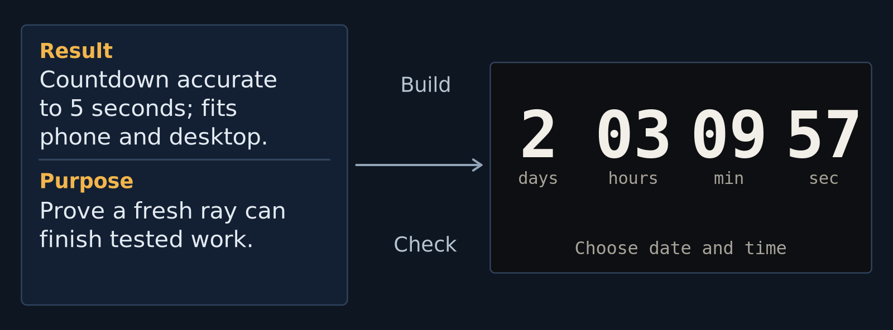

Edition note: This chapter describes the wider system and an earlier public kit. The supplied kit has an editable owner board, automatic declared Checks and invitation-scoped sharing; automatic agent execution is not included. See the [current Guide](../GUIDE.md).

**Summary.** You decide what you want to achieve and why it matters. ARPE lets you direct the work from a board, while your agents plan, carry out and test the work. You can see what is done, what still needs work and what needs your decision.

# 01. What does ARPE do for me?
  
*You choose the outcome and why it matters; the agent builds and checks the countdown page.*

ARPE stands for Agentic Result-oriented Purpose-driven Execution. Your Result describes what must become true, your Purpose explains why, and Execution is the work your agents do to get there.

You set the destination and the reason for going there; your agents work out how to get there.

You do not have to give a new instruction for every action. On the board, you can change the Result or Purpose and see the plan for reaching it. If a plan fails, your agents can change the actions without changing what you want to achieve.

When you give a new instruction, it belongs to the goal it serves. If none of your existing goals fits the instruction, it becomes a new goal. Your agents bring decisions that need you to the board's decision inbox rather than changing what you asked for without your approval.

You have one place to answer questions about choices that need your judgement.

Your agent treats a question about whether work has been done as an instruction to do it. It still asks before acting on matters involving money, secrets, administrator rights or public posts.

You can see whether work is planned, running or done. Done means the work has been verified and has proof, not just that someone has started it. A separate Check tells you whether the Result still holds. A finished feature should also be available to use, not left switched off.

Your goals, decisions and progress stay with the project so that work can continue in a fresh session without you repeating the previous conversation.

You can view the public kit's local board without an AI account, but you need a separately installed and signed-in agent to do the work.

The public kit gives you a read-only project board and a manual workflow, not the full private system's automatic execution. You or a separately configured supervisor must start the agent.

Sharing one board with a team is the intended product, but the full multi-person workflow is not yet confirmed. The recorded system test passed thirteen of fifteen checks, so not everything had been shown to work. The public kit's release and restoration after a reboot were still unconfirmed. The planned rename of the coordinating project was also not confirmed.
