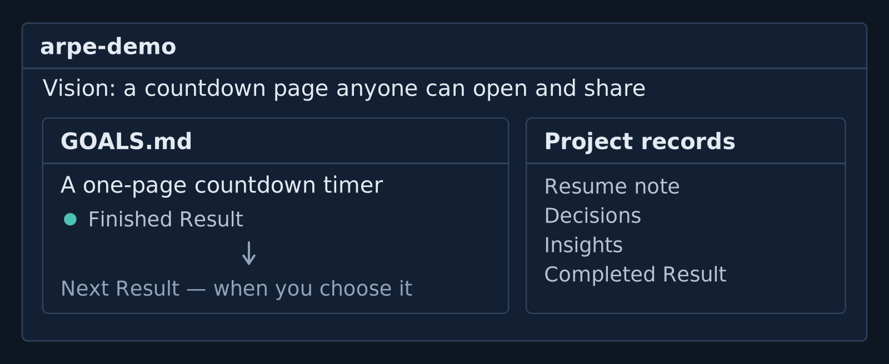

**Summary.** A ray is your project for one continuing mission, with its own goals, decisions and progress. You can finish one Result and start another without losing the purpose or history of the ray.

# 02. What is a ray?
  
*The ray keeps its mission and records when a finished Result is replaced.*

You use one ray for one mission. Each has a vision, a purpose, roles and current Results. You can replace completed Results while keeping the same mission, and keep Results that describe a quality you want to maintain.

Your ray gives a lasting home to the work even as your individual goals change.

Your ray keeps its own private record and version history of what you are trying to achieve. It refers to the places where the actual work happens instead of copying them. Your agent works within the ray and the areas listed for it.

If another ray owns part of the work, your agent sends it a note rather than making changes on its behalf. You can find those notes in the project's Notes tab. A note can remain there until the receiving ray starts again.

Your ray's goal file, `GOALS.md`, holds the current Results, their purposes, plans, checks and progress. Its project description records where things stand. Lasting decisions and lessons are kept as a history, with new entries replacing old conclusions rather than erasing them.

You can return to your project and see what was decided and what was learned.

You also have a current resume note, updated as work progresses. It says what has been achieved, what work is underway, what comes next, what needs you and what has already failed. A fresh session can use it to continue the mission.

Your private working material stays separate from material intended for the public. You should not put secrets in the ray, even though its records are private.

You can see a project on your board even when its agent is not running.

Stopping a ray does not delete its goals or history. You can start it again later. A project appearing on the board therefore does not mean work is currently underway.

Creating a project through the board alone does not set up everything a fully created ray needs. The specification does not confirm the current document index or the planned rename of the coordinating project.
