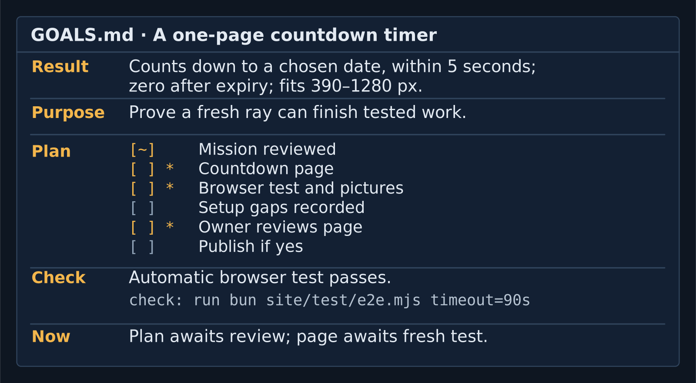

Edition note: The current command's starter includes a runnable file-age Check; it still needs a Check that proves your own Result. See [the Guide](../GUIDE.md#4-start-your-own-project).

**Summary.** You use `GOALS.md` to describe what success looks like and why it matters. Each Result has a plan, a Check and a sentence about current progress. The format can be checked separately from whether your Result is actually true.

# 03. How do I write and check my goals?
  
*A Result has its Purpose, a plan of cards, a Check and a sentence about what is true now.*

At the top of your goal file, write the Ultimate Vision: what your ray looks like when it has succeeded. Write the Ultimate Purpose to explain why that matters. Give yourself two or three Roles that describe your identity in the mission.

Each week, update the dated review with what is done, what you crossed off and what you carried over.

You keep the mission, its current goals and the ways to reach them together in one readable record.

You can have one to eight numbered Results at a time. Give each a title and the fields Result, Purpose, Plan, Check and Now, in that order.

Write each Result as a specific, measurable outcome rather than an activity. Keep it to a sentence of no more than forty words. Start its Purpose with “because” or “so that” and explain why reaching the Result matters.

Your agents write a Plan of three to nine cards, ordered by importance rather than by the order in which every action must happen. At least one card and no more than half are marked as musts. Each unfinished card says who will do it and roughly how long it will take.

Your plan shows the important actions without committing you to doing every one if the Result can be reached another way.

You can read the marks in the goal file: `[ ]` means planned, `[~]` means running and `[x]` means done. An asterisk after the checkbox marks a must. Each Result's plan has one running card unless all its cards are done. A done card needs a `proof:` line with evidence beneath it.

Write the Check as the condition that proves your Result holds, with exactly one indented `check:` line that can run it. Write Now as one plain sentence about what is true at present.

You can change the category's vision and purpose and each Result and Purpose on the private board. Your agents maintain the execution details. When a Result is reached, replace it with the next one unless it is a quality you want to keep.

You can check whether your goals follow the method and see which rules they break, but that score does not tell you if the work succeeded.

The method checker can pass with some advisory rules failing. It does not check whether outcome evidence is fresh, whether a failing Result has all cards marked done or whether a quarterly review is due. It also does not enforce the number of Roles, unique Result numbers or the quality of your Now sentence.

The board's starter goal is incomplete and does not pass the method checker as supplied. The starter created by the project command includes a Check that cannot run as written. A manual-only Check is accepted by the outcome runner but fails the method checker's runnable-Check rule. The board can show work shared between you and your agent, but automatic selection of those cards is not confirmed.
