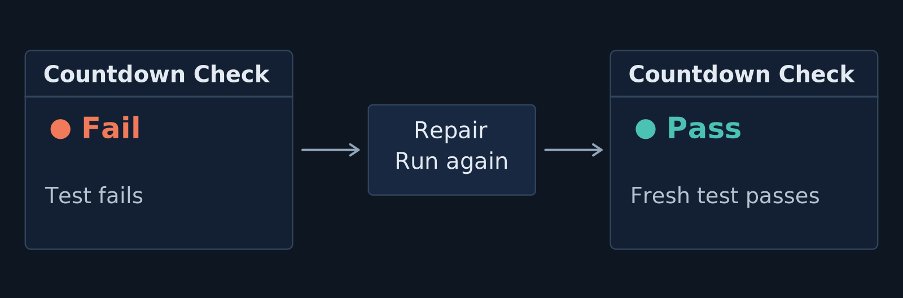

**Summary.** Your Check tells you whether the Result you asked for still holds. You can read its verdict, evidence and age on the board. Finished work is not the same as a passing Check.

# 04. How do I know my Result holds?
  
*A failed Check calls for a repair and a fresh test, even when cards look finished.*

Decide what observation would convince you that the Result is true. Describe that condition in the Check field of your goal, and have your agent add one indented `check:` line that performs the test.

You can have your agent test the Result with a program, a web request, a file freshness test or a recorded judgement.

Use the `run` mode for a program, `http` for a web request, `file` for freshness and `manual` for a judgement. A program passes when it finishes successfully within the allowed time. A web request passes when it receives the exact response status you asked for. A file freshness test passes when the specified file exists and is younger than the stated limit.

A web response does not prove that the contents are correct, and a recent file does not prove that its contents are useful. Make sure your Check measures the condition you actually care about, not just something easy to test.

If the condition cannot be tested automatically, your agent can record a manual pass or fail with a note giving the proof.

You can tell whether your evidence is recent, missing or waiting for a manual judgement.

On the board, PASS means the recorded test passed and FAIL means it failed. STALE means the evidence is at least twenty-four hours old. NEVER means no valid test result is available, and MANUAL means a judgement is needed but has not been recorded.

Automatic checks are attempted at most once every ten minutes per goal. You can also request a run, subject to that interval. The run control is unavailable for manual or undeclared checks.

You can read the latest output and its age, then open the details to examine the evidence.

When your agent starts, it runs the Checks and repairs failures before doing other work. A completed card without proof can also cause a failing light in the goals view, even when the executable Check passed. The project view does not apply that same proof override.

If you change the Check, the board can still show the old verdict until the next test or report. A Check can run local programs without isolating them, so use only declarations you trust. The demo's lights are sample data, not proof of live work.
