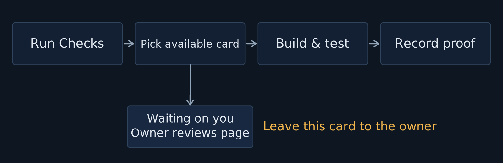

**Summary.** Your agent starts by checking your goals and fixing what fails. It then takes the most important available work, verifies what it does and records the result. You keep control of your own actions and decisions.

# 05. How does my ray keep working?
  
*The agent checks first, then takes available work, tests it and records proof.*

When you start a ray, your agent reads the project's description, goals and latest resume note. It runs the Checks and repairs anything that fails before moving on to the plan.

Your agent checks what is already supposed to work before it starts new work.

Your plan tells the agent what it can do next. It takes the first available must, or the first available card if there is no must. If it already has a card in progress, it does not take another one through this selection process.

Your own cards are left to you. A card waiting for your decision is left alone until you answer. Look in the board's decision inbox when your agent needs a choice from you.

You can distinguish work that has started from work that has been verified and finished.

Your agent marks the card running before starting. It tests what it produces and marks the card done with proof. It also updates the goal's Now sentence with the current result and its evidence.

Large pieces of work can be sent to a second AI while your agent carries on with other work. A returned answer must still be applied and tested before you can count it as done. If that other AI is unavailable, your agent is instructed to do the most important waiting work itself.

Your agent can choose its next available card from the plan without you having to repeat the instruction.

In the private system, a running session can return to work when you send a message, when delegated work returns or when there is more work on the board. It can also wait when there is nothing it can take. Automatic work is bounded and may be paused, so this is not a promise of uninterrupted progress.

Work shared between you and your agent is represented on the board, but the specification does not confirm that automatic selection handles it correctly in the running session. The overall pause does not stop every automatic return to work. Sessions have resumed needlessly in the recorded system. A fix was recorded, but a full day without unnecessary interruptions had not yet been demonstrated.
