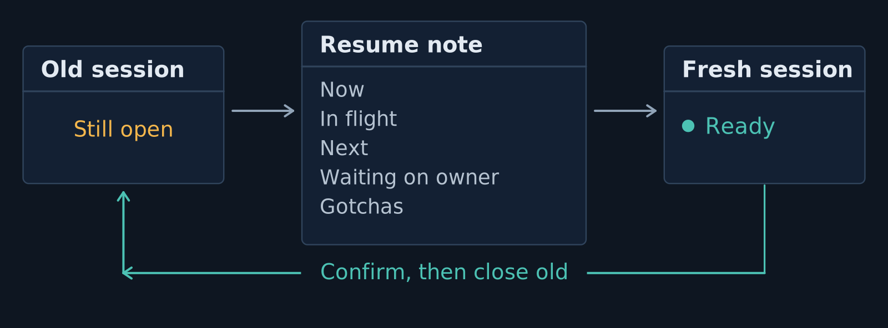

**Summary.** Your project keeps its progress in written records so a fresh session can continue the work. During a planned handover, the old session stays open until the new one confirms it is ready. When there is no work to do, an idle session can close and reopen when work returns.

# 06. How does my work continue in a fresh session?
  
*In a planned handover, the fresh session reads the resume note and confirms readiness before the old one closes.*

You do not have to repeat your instructions every time a session starts. Your ray keeps one current resume note and updates it after each meaningful step.

You have one current account of where your work stands.

The note tells you what has been delivered and shows its evidence. It records the work underway, what should happen next, questions waiting for you and failed approaches that should not be repeated. Lasting decisions and results are recorded separately.

A session can start fresh when its conversation grows too large or when you request a restart. A busy session or one on hold can delay the change. Starting fresh can also reduce the cost of carrying a long conversation.

Your old session is not closed in a planned handover until the new session has confirmed readiness and is still running.

If the new session fails to confirm in time, ARPE keeps the old one when it is still running. If the old one has already disappeared, the new one is retained for manual recovery.

An idle session can be parked instead of replaced immediately. A new plan, a returned or failed handoff, an empty work queue, a newly failing Check or a restart request can bring the project back to work.

A newly failing Check can bring your parked ray back into action.

The confirmation cannot prove the new session understood everything, and the handover does not prevent all outside edits.

The complete handover procedure still needs verification on the actual desktop because the available restart instructions do not agree.

A replacement window once remained hidden; the recorded fix restores its normal name, but does not guarantee it returns to the same workspace.

Manually reopening a ray does not have the same proven safeguards as a planned handover.
