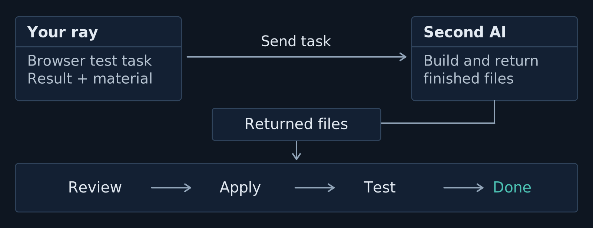

**Summary.** Your ray sends substantial work to a second AI with the material and instructions needed to produce finished files. The returned work is reviewed, applied and checked before you rely on it. If a handoff fails, your ray can recover the reply or continue the work itself.

# 07. How does a second AI help with my work?
  
*Returned work must be reviewed, applied and tested before the ray counts it as done.*

Your ray delegates work that needs serious thinking, such as research, building, calculation and testing. Handoffs should normally be large enough for thirty to ninety minutes of work; larger tasks are split.

Your ray asks for finished files and specifies how the returned work must be checked.

The request includes the intended result, the people it is for, the actual material, the constraints and what counts as success. You should not receive a claim that an unrun check passed.

Each ray has a queue of work waiting to be sent and a shelf of prepared tasks for later. The queue is replenished from that shelf when it falls below its target. Work can wait because other rays share the same capacity or because sending is temporarily limited.

The target for work in progress is not a guarantee of how many tasks will run at once. Preparing extra tasks automatically is available separately, but is not integrated into the shared queue.

An older way of running handoffs for individual rays can prevent the shared system from starting, and some instructions still describe that older arrangement.

Prepared attachments are checked but are not guaranteed to belong to the right ray.

Sending too many requests too quickly has caused a block before. ARPE spaces requests apart and pauses after repeated failures. Automatic detection of upload limits and their reset times is not established.

When your task requires finished files, a reply alone is not enough to count it as complete.

If a download fails, ARPE keeps the reply and can try to recover the files. When a link has expired, it can ask for the same files again. If it cannot establish whether an original request was sent, it does not simply send it again.

You can distinguish work that was used from work that was set aside, with a reason for rejection.

Ordinary handoffs are not applied automatically on arrival. Your ray is expected to apply and check useful results the same day.

The second AI's advice is not permission to change what you asked for.

If handoffs remain blocked, the ray should tackle the most important work itself rather than wait.
