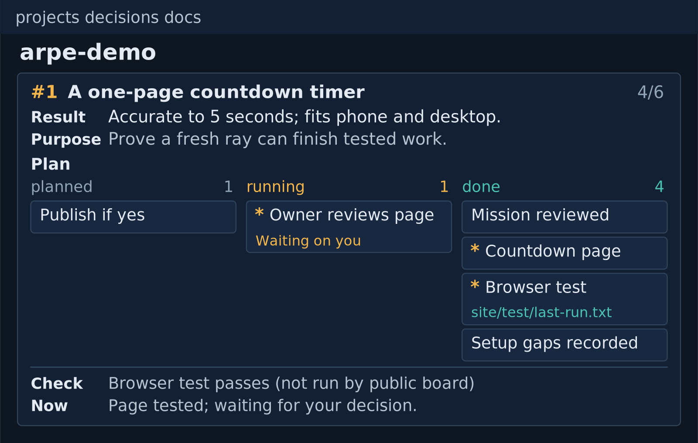

Edition note: The illustration and this chapter describe the earlier board. The current public kit runs declared Checks, saves chat instructions as notes and does not include the private live-session or handoff automation. See the [current Guide](../GUIDE.md).

**Summary.** The board is where you see your projects, their Results, their progress and the evidence behind the work. You can edit the outcome and its purpose, inspect cards and send instructions. You can also read documents, conversations and decisions without leaving the project.

# 08. What can I see and do on the board?
  
*The countdown demo at owner review: four of six cards are done, one waits for you, and publication is still planned.*

The projects list shows each ray's vision, whether its session is running, its progress and its last activity. Expand a project to see its Results, or click its row to open it.

You can create a project from the board when editing is enabled. This creates its initial goal and project documents, but does not launch a session or create a repository.

You can see each Result, why it matters, its progress and the work in the planned, running and done columns.

The Check light tells you whether the Result passed, failed or has stale evidence. Hover over it to see when it last ran. A manual Check can still be waiting for a report.

You can change your vision, the project's purpose, a Result or its Purpose by clicking the text. Press Enter to save or Escape to cancel. The execution plan is maintained by the agent, not edited through these board fields.

Open a card to inspect its evidence, linked decision and the work sent to the second AI.

The card itself shows the task, produced files, a pending question or a failure label when relevant.

Card details do not yet show who must act, how long the task should take or whether it is mandatory.

A card may move as linked work progresses, but work that you share with the agent is not complete merely because a handoff was applied. Open the evidence and check whether the Result itself holds.

In Handoffs, you can distinguish work that was applied, set aside or returned but not yet applied. You can inspect requests, replies, returned files, failure reasons and waiting reasons. Queue positions can be estimates, and the exact reason for a wait is sometimes unavailable.

You can find unfinished or failed handoffs, past decisions and documents in the project tabs.

The other tabs collect your conversations, insights, changes, plans and notes. Documents can be read on the board or opened as PDFs.

Source quotations embedded in documents are not yet rendered by the board's document viewer.

Use Chat to send instructions to your ray. A message may be saved as a plan if no session is available to receive it. A long reply opens in a separate panel within the board.

Settings let you change the amount of work kept ready for a ray, the shared work limit, when sessions should start fresh and where projects are kept.

The wider board also provides statistics, benchmark results and comparisons of changed files. Cost figures in the statistics are estimates.
