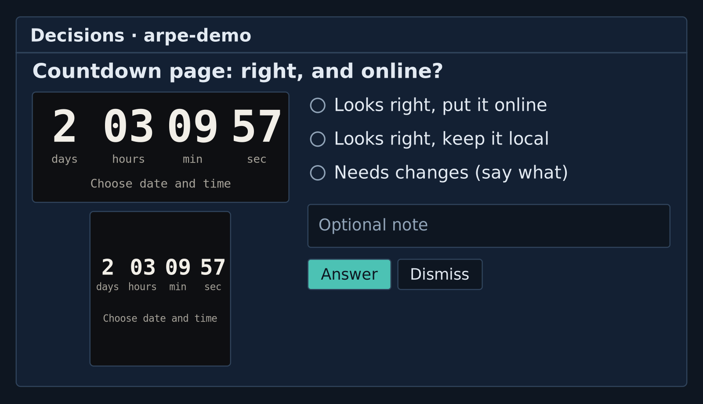

**Summary.** When a ray needs your judgment, it brings a question to your decision inbox. You can choose an option, leave a note when allowed or dismiss the question. The ray records your answer and uses it to continue the work.

# 09. How do I make decisions about my work?
  
*Open the countdown question, inspect the page pictures, choose an answer and submit it.*

Look in the board's decision inbox for questions that need you, rather than searching through chat. The oldest pending questions appear first. The notification menu shows which ray is asking, how long the question has been open and which card it concerns, if any.

You can compare choices and their images, select an answer or send your own note when the question allows it.

A question may also have a deadline. The inbox tells you when it has passed. Some questions ask only for a written reply.

Click an option to submit it. You can include a note of up to five hundred characters when notes are allowed. If you have nothing to add, choose Dismiss. You can change a saved answer while its question is still waiting to be archived.

You can also answer a question directly from its linked plan card. A card waiting for your decision has a question mark. The agent is instructed to leave it alone until your decision is recorded.

You can answer or dismiss a question from the card and see the question marked as answered.

Dismissing a question tells the ray to drop it, decide for itself or move on, but dismissal does not yet reliably release a linked card for work.

The board and the agent can also disagree about whether a shared card is ready to start.

Your answer is saved even if the attempt to notify the ray fails.

An answer on the board is not proof the ray has already received or acted on it, and the board does not report whether the notification succeeded.

The ray must read the saved decision, act on it and archive the question and answer; archiving is not automatic when you reply.
