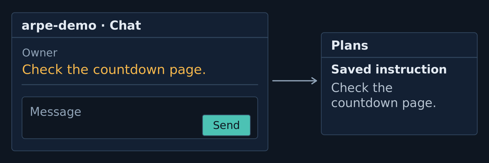

**Summary.** You can give instructions through the board and send material to the coordinator, who directs it to the right ray. Rays keep written notes so instructions are not lost when a session is unavailable. You receive change notes and digests showing what has moved forward.

# 10. How do I talk to my rays and hear back?
  
*If live delivery is unavailable, a saved plan keeps the instruction for the ray to read later.*

Use the project chat to give an instruction to the ray doing the work. If the session is busy, the usual delivery happens after its current step. Sending can be refused while sessions are switching or when more than one session is running for the ray.

Your instruction can be saved as a plan when no live delivery route is available, and the board tells you when delivery is uncertain.

If delivery is uncertain, check the conversation before sending the same instruction again. A saved plan or a submitted message does not prove that the ray has read it.

Rays also exchange notes. A note is saved in the receiving project before the sender attempts to notify its session, so the note remains even when no session is running.

Information passed between your rays is kept in writing even if immediate delivery fails.

The coordinator is your inbox for links, ideas and reference material. It is expected to save each item, track its intended use, send it only to the ray responsible and follow the work until it is done.

If work is stuck, it should act on the problem and check the repair before reporting it to you.

Questions requiring your judgment belong in the decision inbox. Ordinary chat replies are meant to be short. When a reply needs more space, the ray should give you a change note instead.

You should see what is new rather than repeatedly receive the whole document.

The ray should open the actual page or document when you need to inspect, click or approve something.

A long board message currently opens inside the board; automatic opening of a separate note for every long reply is not established.

Documents opened for you are also meant to reach your Saved Messages. Longer documents and images can arrive as page pictures or files, while short notes can arrive as text. If a document cannot be rendered, you may receive only its first image or a text description.

Repeated copies of identical content are normally suppressed.

The status report shows what each ray is doing, what is next and what needs you.

The digest brings together changes since the last one opened and produces nothing new if nothing moved. A failed opening can be retried.

ARPE checks for results that have not been followed by a recorded change-note page delivery. This check cannot prove that you read the note or that it covered every result, and short text messages do not count as page deliveries.
