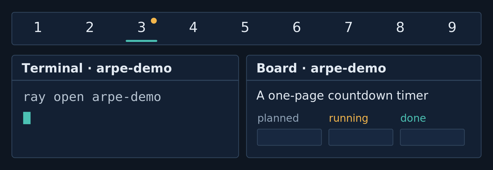

**Summary.** You get a workspace for each ray, with its own terminal and board window. You can switch between workspaces and see which ones have work in progress.

# 11. How do I move between my rays?
  
*Click a numbered workspace to switch rays; the underline marks your current workspace and amber means busy.*

You have nine numbered workspaces. A new ray takes a free workspace when one is available, or shares a workspace when they are all in use.

Click a workspace in the bar to switch to it; the underline shows where you are and an amber dot means a ray there is busy.

Your terminal and project board open together. All your rays share one board behind their individual windows, so closing one board window does not stop the others.

When a fresh session takes over your ray, it should return to the same workspace.

Your replacement window is placed back and ARPE tries to give it the ray's usual name.

A replacement window has been hidden before because its name did not change, and successful placement still does not guarantee that it is visible. The stated window layout is not confirmed by the supplied implementation.

You do not need separate background services for each ray. A separate service for one ray once stopped handoffs across all rays, so shared-service problems belong with the coordinator, who is responsible for repairing them and checking the result.

When you receive a long chat reply on the board, click Read to see the full message.

You can read the whole reply without having to leave the board.

Long documents use a separate viewer, but long board replies do not automatically open there.
