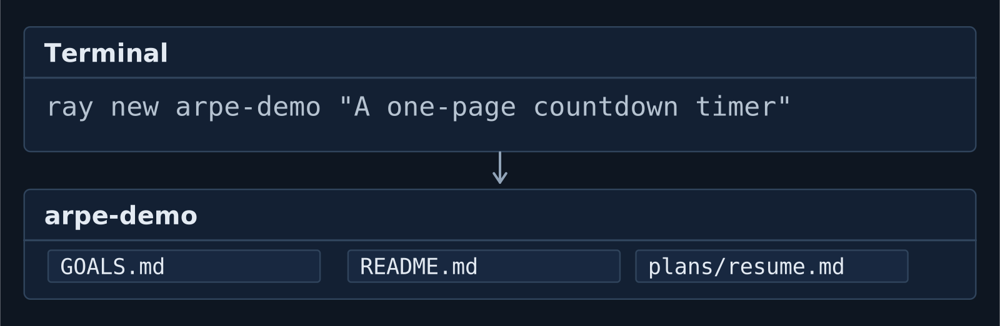

Edition note: In the public kit use `arpe` instead of `ray` (the latter is a compatibility wrapper). `arpe new` creates the project without launching a session; use `arpe open` separately. See the [current Guide](../GUIDE.md).

**Summary.** You start a ray by giving it a name and a mission. ARPE prepares a private project record and opens your working session and board.

# 12. How do I create and run a ray?
  
*Give the ray a name and mission; its starter files still need a measurable Result and Check.*

Choose a short name using lowercase letters, digits and hyphens, starting with a letter or digit. Run `ray new NAME "MISSION"` with your own name and mission. You can also choose a workspace with `--workspace` and a number from one to nine.

You get a starter GOALS.md based on your mission, ready for the agent to turn into measurable work.

The starter plan is not evidence that your mission has been achieved: you still need a measurable Result and a Check that tests it. The agent's first task is to define them.

You get a private record of your plans, decisions and progress, kept separately from your product code. A separate product repository is not created for you. A shared-service restart failure once left a ray half-made, but it no longer stops creation.

On first use you can choose where your rays and product repositories belong, or accept the defaults. You can revisit those choices with `ray settings`, although opening a ray from a different ray folder location is not fully supported.

Use `ray open NAME` to return to a ray. If your session is already running, ARPE does not start a second one.

Run `ray stop NAME` to close your session and its board window without deleting your work or stopping the shared board.

Use `ray board NAME` to open or close just the board window. Use `ray list` to see your rays, their workspaces and whether their sessions are open.

Run `ray restore` to reopen the rays and board windows you had left open.
