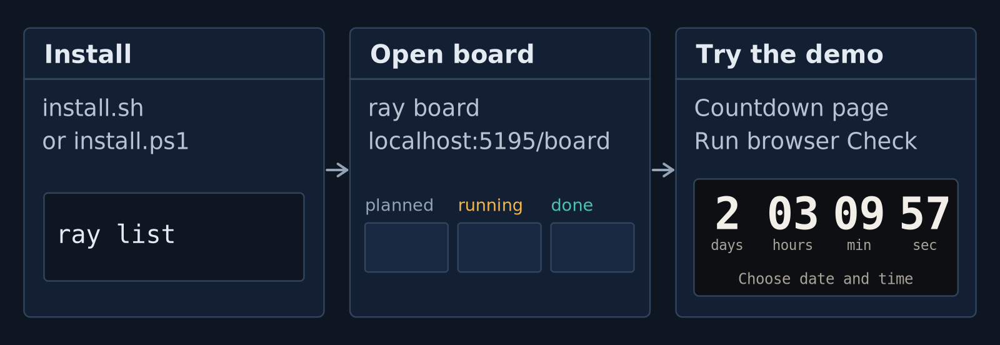

Edition note: This chapter describes an earlier public kit. The current kit uses `arpe`, runs declared Checks automatically, supports invitation-scoped sharing and includes local transcript chat, saved notes and stats. It does not ship the private live-session messaging hook, automatic handoff delivery or autonomous agent execution. See the [current Guide](../GUIDE.md).

**Summary.** You can try ARPE on your own computer with the public kit, without an AI account. You get a local board, starter projects and the means to check results and review returned work, but not the full private setup.

# 13. What do I get with the public kit?
  
*Install the kit, open its local board and try the countdown demo before starting your own mission.*

Run the default installer for Windows, Linux or macOS to prepare the local board and a demo ray. You can choose where to keep your rays and which agent to use. The installer starts your board and prints its address.

You get a ready-to-open board, a starter project and the commands you need to create and check rays.

Try the included demo before starting your own mission. You can inspect its plan and see how a Result is connected to a Purpose, a Check and the evidence on completed cards.

When you want an agent to work on your project, install and sign in to your chosen agent separately. Use `ray new NAME "MISSION"` to create your ray and `ray open NAME` to open it; unlike the private setup, creating a ray does not start a session for you.

You can list your rays with `ray list`, open the board with `ray board` and reopen active rays with `ray restore`. Use `ray stop NAME` to stop a managed session without closing the shared board.

Your board is local to your computer. You can read the project and answer decisions linked to cards.

You can choose an answer to a pending decision, add a note if allowed and leave the saved answer for your agent.

You can check the structure of your goals and run separate checks of the actual result. A well-written plan does not prove that the result works. The included countdown demo records a plan that initially failed five rules and was then repaired, with separate tests of the page itself. The older check-running website demo is available through the separate legacy installation.

You can review the differences in returned work and decide whether to merge or skip it. Work that cannot be matched to a repository is not applied, and you need a clean working copy before merging.

The public board does not edit your general plan or run outcome checks automatically. You also do not get automatic handoff delivery, private desktop workspaces, session handovers, live chat and usage integrations, notifications or automatic startup and supervision.

You can uninstall the kit and keep your projects; deleting an installer-created project folder requires an explicit purge.
