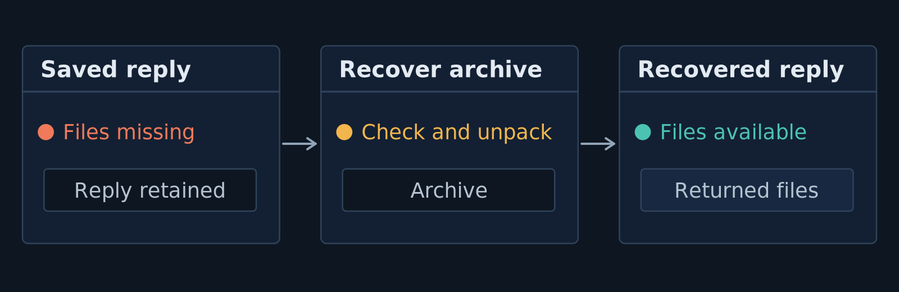

**Summary.** If your work stops arriving or a session seems stuck, the problem may be delivery rather than the work itself. ARPE has recorded failures and added safeguards, but some repairs still need to be confirmed.

# 14. What can go wrong with my rays, and how is it caught?
  
*When files are missing, recover and verify the archive rather than treating the reply alone as finished work.*

When many old conversations are reopened, access can be temporarily limited and you may have to wait for a completed reply. ARPE spaces out recovery attempts and pauses when it encounters a limit, rather than retrying the original request.

You only get a recovered reply marked as such after the downloaded archive has been checked and unpacked.

A pause can also be a false alarm. Text in a conversation list was once mistaken for a limit and stopped new work across the rays. The detection now excludes that list and unsent prompts.

An update once broke sending and receiving for every ray. Reloading the affected browser component restored it, and the recorded prevention is to check updates before putting them into use. Automatic recovery when that component cannot start is not established, and a live test is still needed to prove that a reload loses no work.

Your idle session may resume unnecessarily, increasing the cost without advancing your work. A repair to prevent repeated resumes was recorded, but the supplied implementation does not confirm it.

A new session may be working while its window is hidden from your workspace. This happened when a replacement window retained its temporary name.

ARPE tries to restore the replacement window with the usual ray name, but it does not verify that the name changed.

Your long sessions can cost more because they repeatedly read their accumulated conversation. Fresh sessions need to build some context again, so ARPE takes account of both the size of the session and how long it has been idle before starting afresh.

You may see new work delayed while the shared system is still running. Its activity log uses UTC, while the time given for the end of a pause is local; comparing the two without accounting for the difference once led to a false report of a long outage.

Your usage report can overstate costs if the same message is counted more than once or if old prices are used.

Repeated usage records are counted once when they have identifying information, so the corrected estimate is more reliable.

You should still treat the cost report as an estimate rather than an invoice: records without identifying information can be counted more than once, and the estimate depends on the assumed prices and cache lifetime.

Your plan can look unchanged while a change in line endings causes a test to misread cards and time out. The affected tests now normalize line endings or restrict how indentation is read.
