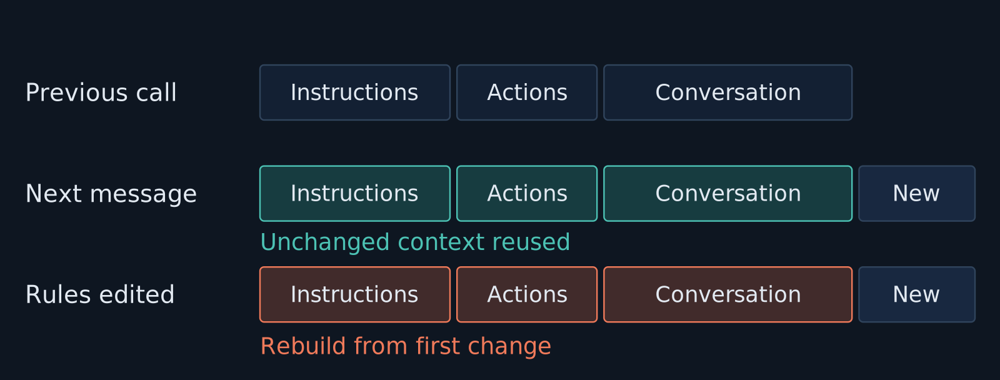

**Summary.** Your session sends its instructions, available actions and conversation with every call. Reusing the unchanged part from the cache makes calls cheaper, but changes and long idle periods can make that saving disappear.

# 15. How can I keep my session costs down?
  
*Keep the earlier context unchanged to reuse the cache; editing instructions or waiting past expiry can require rebuilding it.*

You keep the conversation reusable by leaving its earlier messages unchanged and in order.

Changes to instructions or available actions can force the cache to be rebuilt from the first difference. Batch edits to shared rules instead of making them one at a time, since they affect every running session.

Idle gaps were the largest recorded cause of expensive cache misses. Your sessions request a one-hour cache; if a large session resumes after expiry, its context must be rebuilt. Resume a session within the cache lifetime if you will need it, or let it hand over to a fresh one instead.

Click Context on your board to see how much of the last call was instructions, available actions and conversation.

Use Context and Spend to see recent calls, the day's cost and the causes of cache misses.

You cannot yet read the full context or open its detailed view from the board. You do not get a warning before a shared rules edit invalidates every session's cache.
