# Getting started with ARPE — recorded tutorial

Recorded on win32 (powershell), 2026-11-27T20:36:36.686Z; runtime: bun.

This is an actual disposable installation. Follow [Guide sections 2–4](../GUIDE.md) for the full explanation. The paths and free port in the output belong to this run; use your own printed address. On Linux open a new login shell or run `source ~/.profile`; on Windows open a new terminal. The recorder suppresses persistent Windows PATH changes. No AI account or publishing service is used. This records the manual Guide path, choosing local approval; it omits the optional intentionally failing starter check, external publication, and live agent launch (which requires separate sign-in).

[Watch the captioned MP4 walkthrough](tutorial.mp4) (desktop and phone frames side by side).

## Re-record

```bash
bash test/record-tutorial.sh
```

```powershell
pwsh -NoProfile -File test/record-tutorial.ps1
```

Requires Node 22.13+, installed Chrome/Edge/Chromium (or `CHROME_PATH`), and optionally ffmpeg with H.264 and drawtext support. Bun is the default installer runtime.

## Recorded steps

### 1. Install ARPE

The installer starts the board with a default demo. Load its printed address.

```powershell
pwsh -NoProfile -ExecutionPolicy Bypass -File ./install.ps1
```

Actual terminal output (exit 0):

```
Created demo: <temp>\arpe-tutorial-DAmAR8\home with spaces\rays\demo
PASS install: http://localhost:54960/board (runtime: Bun)
PATH: <temp>\arpe-tutorial-DAmAR8\home with spaces\.arpe\bin
```

```powershell
(Get-Command arpe -ErrorAction Stop).Source
```

Actual terminal output (exit 0):

```
<temp>\arpe-tutorial-DAmAR8\home with spaces\.arpe\bin\arpe.cmd
```

Verified: HTTP 200; visible board state.

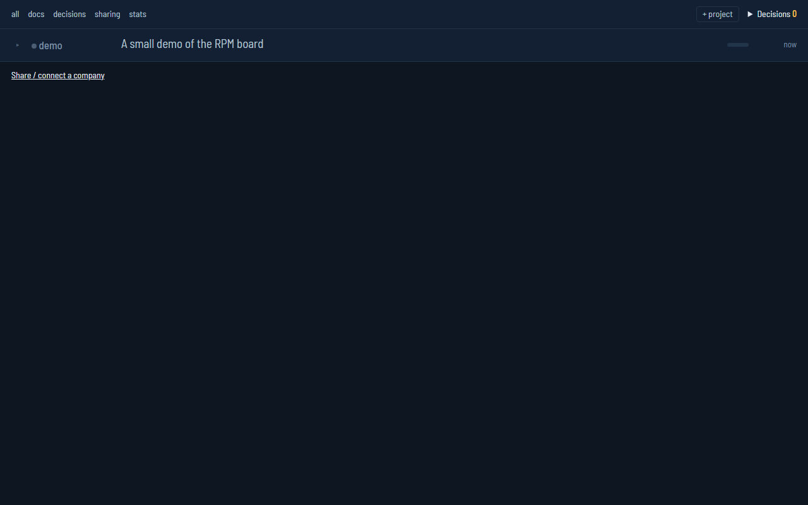

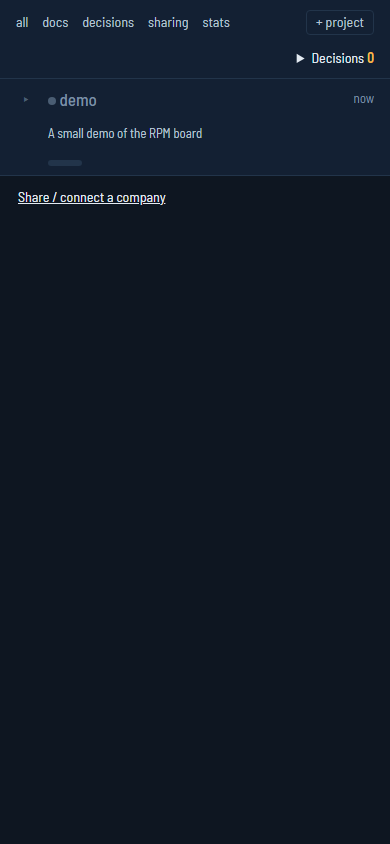

### 2. List projects and open the board

The installed command lists demo and prints the board address.

```powershell
arpe list
```

Actual terminal output (exit 0):

```
demo
```

```powershell
arpe board
```

Actual terminal output (exit 0):

```
http://localhost:54960/board
```

Verified: HTTP 200; visible board state.


### 3. Create a project from a one-sentence mission

The new project appears alongside demo; no agent is needed.

```powershell
arpe new club-page "A public information page for our club"
```

Actual terminal output (exit 0):

```
Created club-page: <temp>\arpe-tutorial-DAmAR8\home with spaces\rays\club-page
```

Verified: HTTP 200; visible board state.

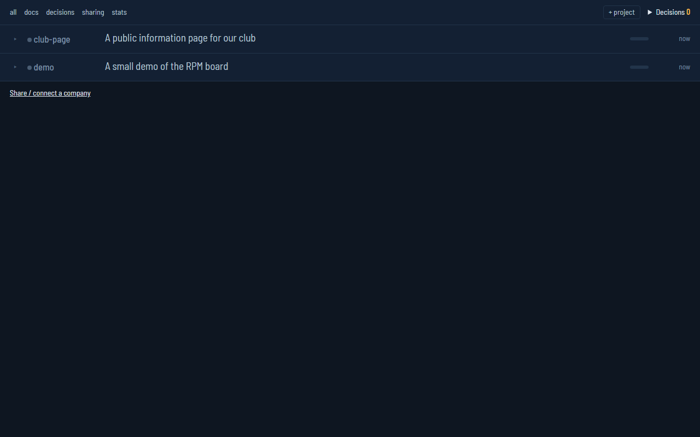

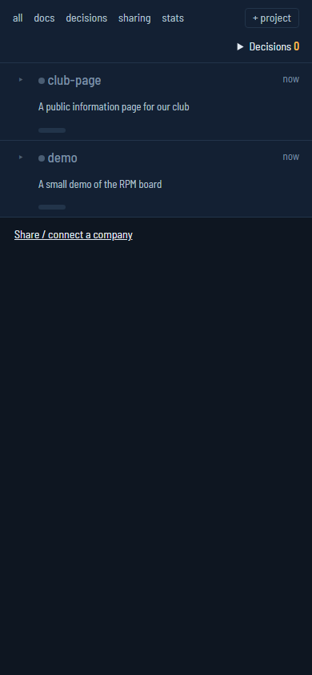

### 4. Open the new project's board page

The starter Result, Purpose, running card and Check are ready for the owner.

```powershell
arpe board club-page
```

Actual terminal output (exit 0):

```
http://localhost:54960/board/p/club-page
```

Verified: HTTP 200; visible board state.

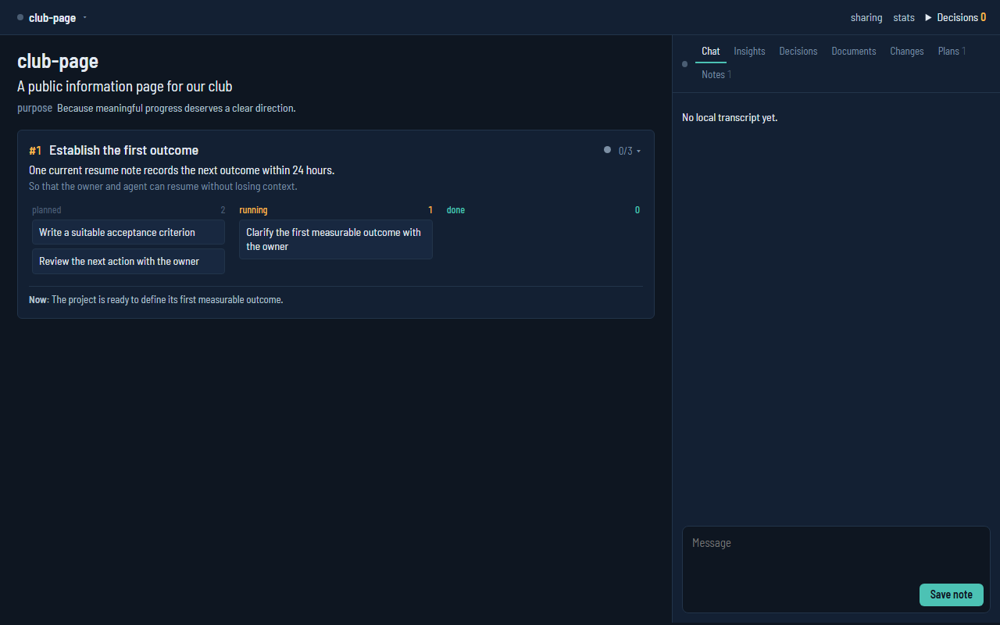

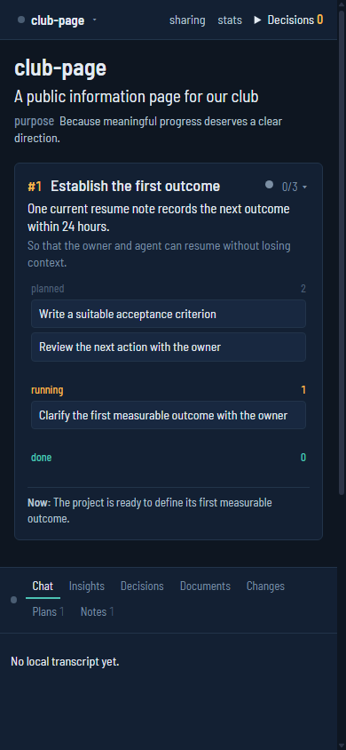

### 5. Open the running card

Click the running card to inspect its details. The starter project has no decision yet.

Browser action: click the running card. No terminal command was entered for this step.

Verified: HTTP 200; visible board state.

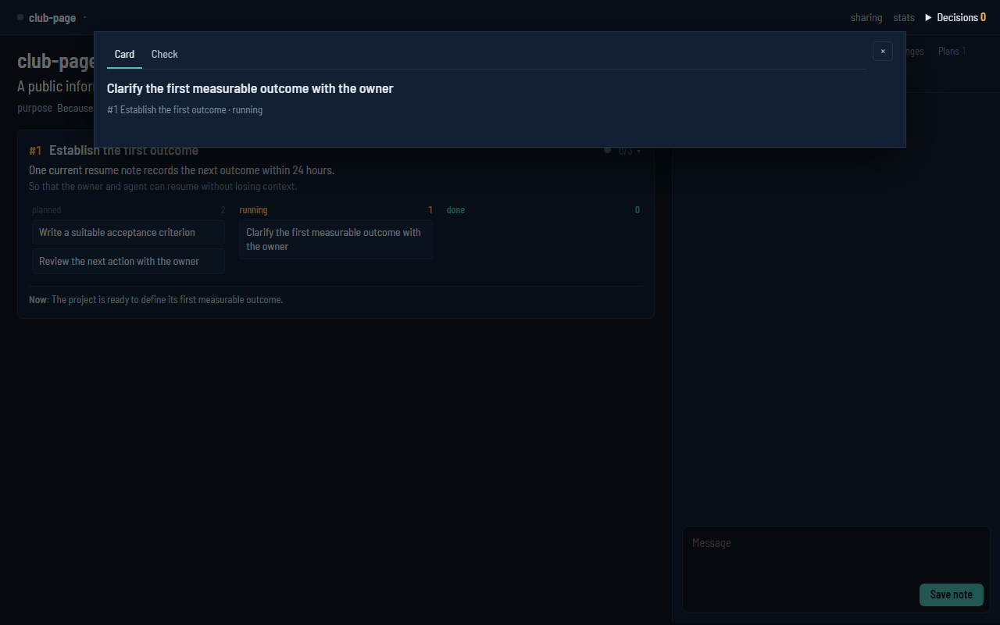

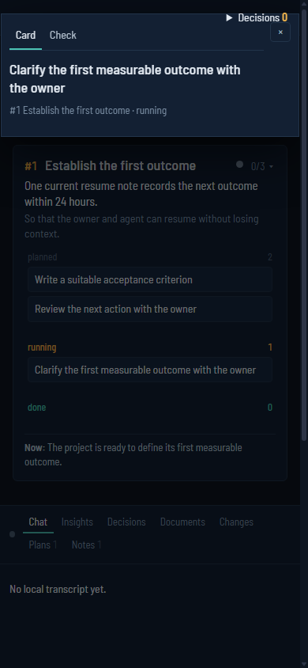

### 6. Copy the countdown example

The Guide's saved countdown example starts at zero of six cards. Its page and test are included.

```powershell
arpe new arpe-demo --from examples/arpe-demo
```

Actual terminal output (exit 0):

```
Created arpe-demo: <temp>\arpe-tutorial-DAmAR8\home with spaces\rays\arpe-demo
```

```powershell
arpe board arpe-demo
```

Actual terminal output (exit 0):

```
http://localhost:54960/board/p/arpe-demo
```

Verified: HTTP 200; visible board state; 0 done cards.

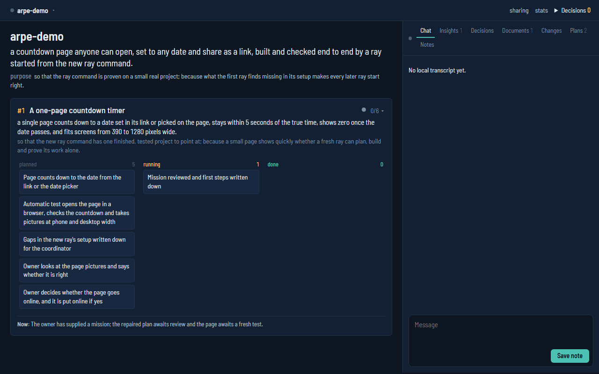

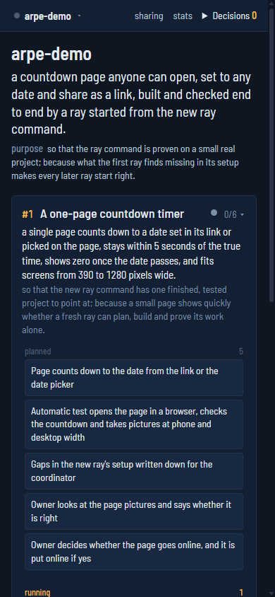

### 7. Review the mission and validate the plan

From the installed arpe-demo directory, review the mission; the structural check passes and one card is done.

From the installed project folder (normally ~/rays/arpe-demo). Recorded working directory: `<temp>\arpe-tutorial-DAmAR8\home with spaces\rays\arpe-demo`.

```powershell
bun replay.mjs prepare
```

Actual terminal output (exit 0):

```
(no output)
```

```powershell
bun ../tools/rpm-check.ts .
```

Actual terminal output (exit 0):

```
PASS hard     R1-header            L2    a countdown page anyone can open, set to any date and share as a link, built and
PASS hard     R1-header            L3    so that the ray command is proven on a small real project; because what the firs
PASS hard     R1-header            L4    Page Builder, Tester.
PASS hard     R2-goal-count              1 goals
PASS hard #1  R2-fields            L10   ok
PASS hard #1  R3-runnable-check    L22   check: run bun site/test/e2e.mjs timeout=90s
PASS soft #1  R4-measurable        L11   40 words
PASS soft #1  R5-outcome-reason    L12   reason word present
PASS hard #1  R6-plan-shape        L13   6 chunks, 1 in progress
PASS hard #1  R7-musts             L13   3 of 6 marked *
PASS hard #1  R8-who               L13   5 open, all assigned
PASS soft #1  R9-duration          L13   open time 2.7h, must time 1.7h
PASS soft #1  R10-no-duplicates    L13   ok
PASS soft #1  R11-not-stalled      L13   ok
PASS hard #1  R13-plain-words      L11   ok
PASS soft #1  R13-plain-steps      L13   ok
PASS hard     R12-weekly-review    L6    2026-11-27 (0 days ago)
score 17/17 (100%), 1 results, hard failures 0: PASS
```

Verified: HTTP 200; visible board state; 1 done cards.

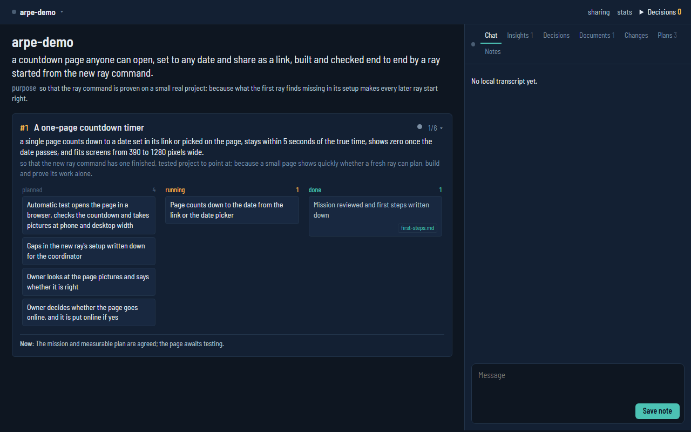

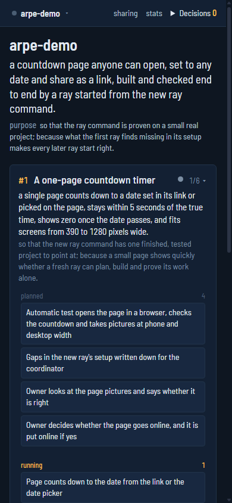

### 8. Run the real browser Check

The five browser checks pass; the board records four done cards and a pending owner decision.

From the installed project folder (normally ~/rays/arpe-demo). Recorded working directory: `<temp>\arpe-tutorial-DAmAR8\home with spaces\rays\arpe-demo`.

```powershell
bun replay.mjs build
```

Actual terminal output (exit 0):

```
PASS remaining matches target (184199s)
PASS counts down (184199 -> 184197)
PASS no horizontal scroll at 1280 or 390 px
PASS past target shows zero
PASS no target falls back to next New Year; picker updates countdown and link
all checks passed (5/5)
```

Verified: HTTP 200; visible board state; 4 done cards.

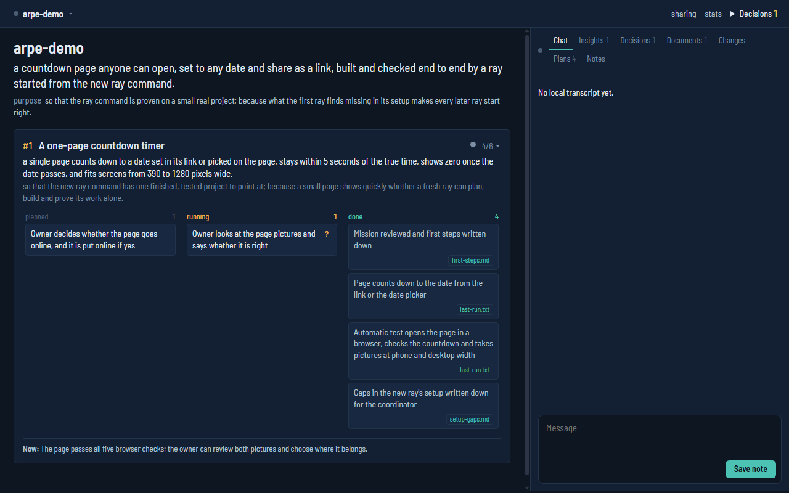

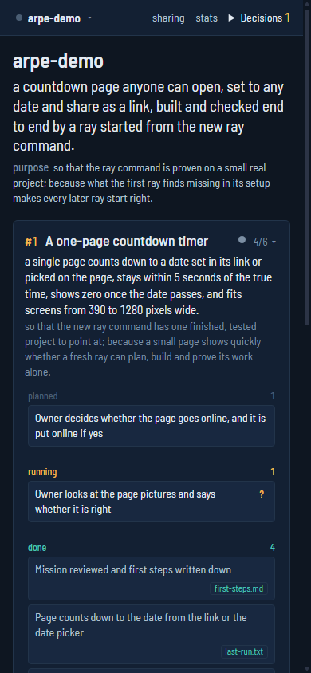

### 9. Open the owner-review card

Click the running owner-review card and inspect the screenshots attached to the decision.

Browser action: click the running card. No terminal command was entered for this step.

Verified: HTTP 200; visible board state.

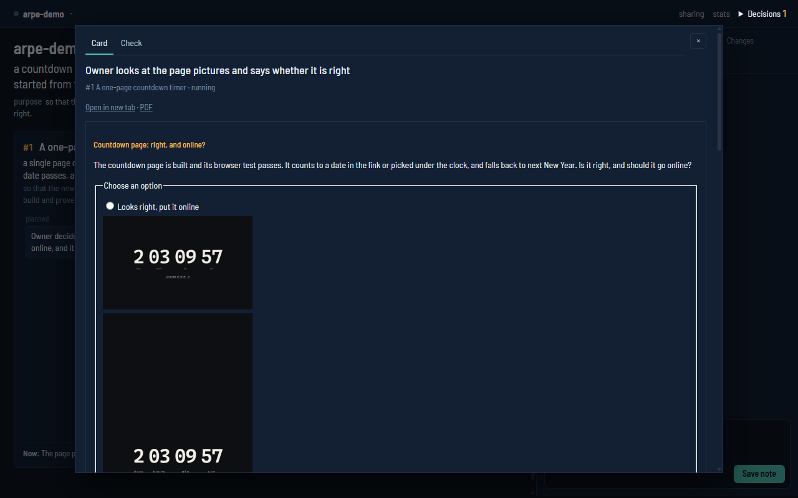

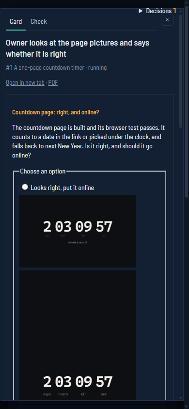

### 10. Answer the decision on the board

Choose Looks right, keep it local and click Answer. No publication is attempted; the saved answer is verified.

Browser action: open the owner-review card, select “Looks right, keep it local”, click Answer. No terminal command was entered for this step.

Verified: HTTP 200; visible board state; persisted local answer.

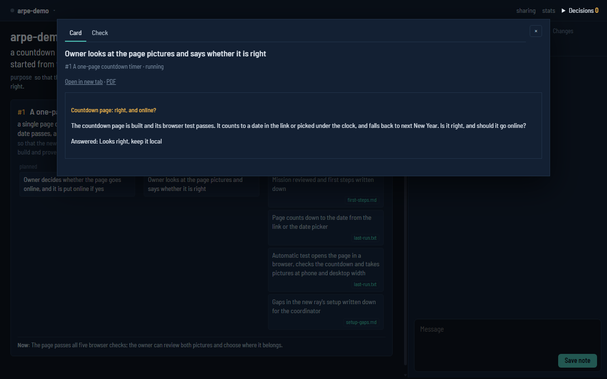

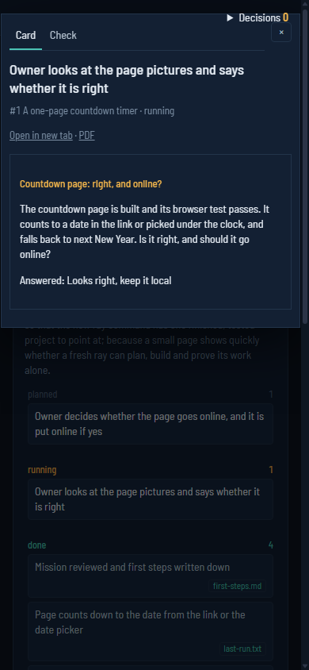

### 11. Finish the local replay

The replay reads the actual saved answer, runs the browser Check again and records six completed cards.

From the installed project folder (normally ~/rays/arpe-demo). Recorded working directory: `<temp>\arpe-tutorial-DAmAR8\home with spaces\rays\arpe-demo`.

```powershell
bun replay.mjs finish
```

Actual terminal output (exit 0):

```
PASS remaining matches target (184199s)
PASS counts down (184199 -> 184197)
PASS no horizontal scroll at 1280 or 390 px
PASS past target shows zero
PASS no target falls back to next New Year; picker updates countdown and link
all checks passed (5/5)
Result reached; board shows six of seven cards. Run close to archive the Result.
```

Verified: HTTP 200; visible board state; 6 done cards.

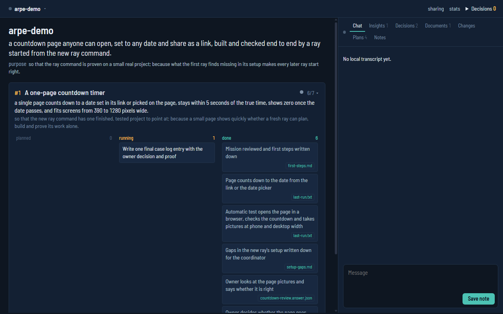

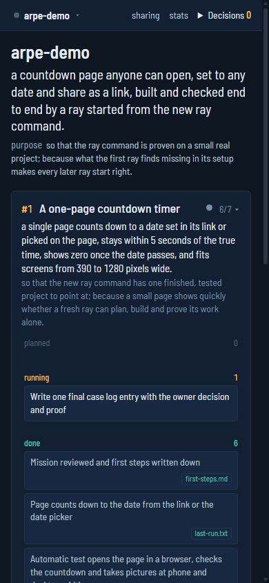

### 12. Archive the completed Result

The final Check passes and the seventh card is done. The Result is archived in the project.

From the installed project folder (normally ~/rays/arpe-demo). Recorded working directory: `<temp>\arpe-tutorial-DAmAR8\home with spaces\rays\arpe-demo`.

```powershell
bun replay.mjs close
```

Actual terminal output (exit 0):

```
PASS remaining matches target (184199s)
PASS counts down (184199 -> 184197)
PASS no horizontal scroll at 1280 or 390 px
PASS past target shows zero
PASS no target falls back to next New Year; picker updates countdown and link
all checks passed (5/5)
Result archived in docs/completed-result.md. Replace or retire it, do not polish it.
```

Verified: HTTP 200; visible board state; 7 done cards.

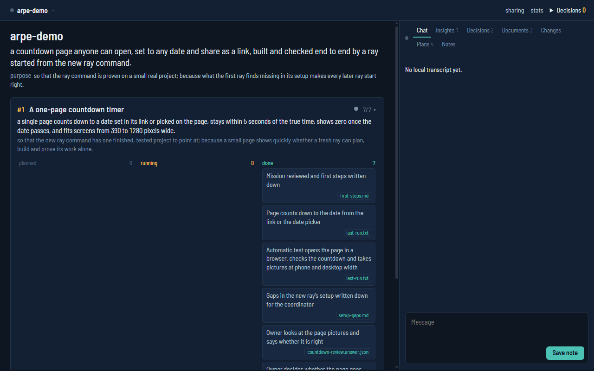

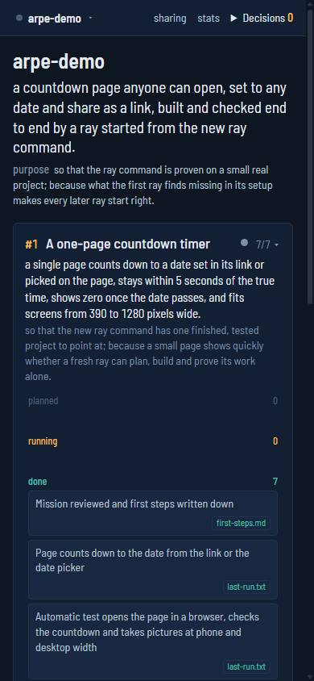

The installer stopped the board and purged the disposable project root. The temporary home was deleted. See [run log](run.log).
