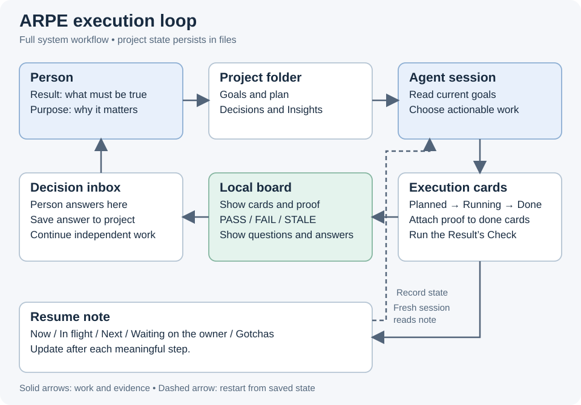
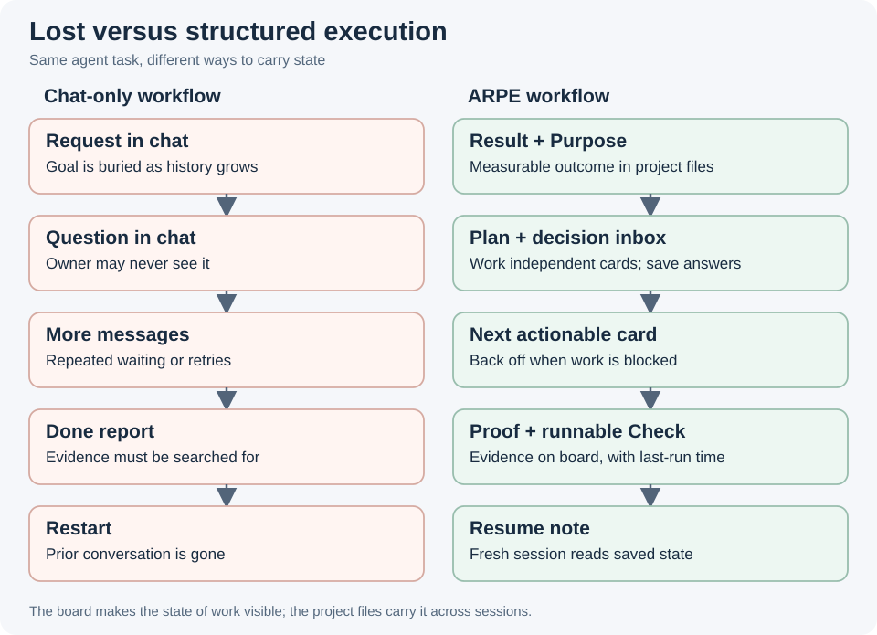

# Why agents get lost, and the structure that keeps them working

A countdown page was built, tested and deployed during an ARPE demonstration. Its browser test passed all five assertions. The board recorded 29 successful runs that day. Yet the agent spent 8 minutes 50 seconds waiting for an answer in chat, and four completed cards appeared without proof. Later, the owner's approval sat unread for 1 hour 17 minutes. The failures were in the way work reached the agent and returned to the person.

ARPE stands for Agentic Result-oriented Purpose-driven Execution. A person owns the Result and Purpose. Agents own Execution. The Result describes a state that can be measured. The Purpose explains why that state matters. Execution is a plan of cards that move through planned, running and done. Each done card carries evidence. Each Result has a Check that tests whether it holds.

The examples below come from the full system used for the countdown project. The [public kit](https://github.com/gberlian/arpe) provides its folder structure, board, check tools and handoff method. Automated supervision in the full system requires additional integration. The public static-site demo includes a deliberately failing check and a repair that can be reproduced locally.

## The goal disappears into the work

The countdown project began with a sentence asking for a demonstration. Its first plan contained a single card: review the mission and propose next steps. The session did that, marked the card done and waited. The starter goals file failed five hard rules of the planning method. It lacked a Check and had too little executable work. After the file was rewritten, the method check passed 17/17.

A conversation records the order in which things happened. As it grows, an agent has more messages to interpret before it can decide what to do. If the only definition of the Result is an early message, the agent has to recover it from that history. A plan that merely repeats the initial request leaves the agent to choose the acceptance criteria as it goes. An agent can finish a plausible task while leaving the actual outcome untouched.

Put the Result and its Purpose in `GOALS.md`. For a countdown, the Result can describe the displayed time, its behaviour when the target date passes and its fit on a phone screen. The Purpose identifies who needs the page and why. The person approves that target. The agent breaks the work into cards with owners, a clear end and an order. It can change how it builds the page while preserving what the page must do.

On the board, read the Result before reading the plan. Look at the running card and identify the next change that can move the Result forward. The planned column should contain useful actions the agent can take. The method checker can find a missing Check or an empty plan. Run the outcome Check separately to measure the product itself.

## The conversation becomes expensive to recover

A session has a finite context window. An old conversation brings its history back into that window on subsequent calls. A fresh conversation has no inherent memory of the preceding session. The project must supply the information that the next agent needs.

A measurement across 37 sessions found that the first call of a fresh session read 32–35 thousand cached tokens and wrote 20–25 thousand new ones when the shared prompt was already cached. The longest coordinator session made 1,444 calls and read 670 million cached tokens in total. The estimate for restarting at 200 thousand tokens of context, reducing it to about 60 thousand, was that the restart paid for itself in about seven calls. These figures measure context use. They do not measure how often an agent forgets a goal.

The structure for restarting is a current resume note. It carries five parts:

- **Now:** the current Result, the latest Check and what has been established.
- **In flight:** work sent elsewhere, with its expected output and state.
- **Next:** the next useful card and how to begin.
- **Waiting on the owner:** decisions required from the person.
- **Gotchas:** failed approaches and the conditions under which they failed.

Update the note after each meaningful step. A new session reads the Result, Purpose, plan and resume note. It runs the relevant Check and finds the next card. It can recover its working state without reading the old conversation.

During the recorded coordinator restart, the old window closed before the new one had spoken. The notes survived, but the owner saw a silent replacement window. A safer handover starts the successor, has it read the notes and acknowledge the current Result, then closes the predecessor. Give only one session ownership of execution at a time so that the overlap does not create duplicate work.

On the board, open the project documents and read the resume note beside the running card. Compare its evidence and next action with the last visible Check. A stale note or a missing description of work in flight is a reason to repair the note before replacing the session. The public kit ships the full resume template separately from the shorter starter note.

## Work is declared done without evidence

The countdown test failed to start twice because a command that wrote its source swallowed a backslash. The agent repaired the line and the test then passed all five assertions in three seconds. It tested the displayed time, ticking, phone layout, an elapsed date and a default target. A test failure gave the agent a concrete problem to fix.

When the agent rewrote the goals file, it left four done cards without proof. It had test output and other evidence in the project, but the lines under the cards were absent. The board displayed a warning. At 17:20 the owner asked why the cards were done. The coordinator reran the browser test, got a pass on all five assertions and attached the missing proof at 17:22.

A status word is easy to change. A conversation can contain a report of a successful test while the board contains only a checkbox. The person would have to find the report and decide which card it supports. The agent that opens the project tomorrow would have to do the same.

Write a proof line directly beneath each done card. For building a page, the proof can name the output and the test result. For a decision, it can point to the recorded answer. Preserve proof when changing the plan. Inspect a proof line and the evidence it refers to before relying on it.

A Check answers a different question: whether the Result still holds. The countdown test was adapted to run against the public page after deployment. The same acceptance assertions continued to apply. Run an actual program or a narrow HTTP or file check when that can establish the criterion. A judgement about appearance may require a recorded human review.

The full system normally ran Checks about every ten minutes. The countdown record contains gaps of 57 and 54 minutes, with the cause unrecorded. The last verdict stayed visible. In the legacy public check board, PASS or FAIL becomes STALE after 24 hours. Read the last-run time alongside the verdict. Open the output when a Check fails. The done column describes past work; the Check and its timestamp describe the most recent observation of the Result.

## A question stops the project

The countdown agent asked for permission in its terminal and waited 8 minutes 50 seconds. Two of its proposed steps could have proceeded independently: writing the test and rewriting the goals. The owner did not read the terminal. The single finished proposal card gave the session no next action.

The person and the agent have different schedules. A question asked in chat reaches the person only when they open that conversation. If the agent has treated the question as a prerequisite for all work, it stops even when part of the plan is independent of the answer.

Put the question in a decision inbox. Give it the context needed to answer, the options and any pictures that make the choice clear. Associate it with the card that depends on it. Mark the dependency as waiting on the owner. Continue an independent open card within the approved Result and Purpose. Keep permission boundaries for publication, spending and other actions that require approval.

Saving the answer is another part of the job. In the full system, the owner clicked at 16:32. The answer was saved, but the session was stopped. The coordinator discovered the answer at 17:49. A fresh session began at 20:20, and the page was online and tested at 20:22. The work took under three minutes; most of the elapsed time was waiting for a session to act.

The board was later changed to send the answer to a running session as well as save it. The delivery was tested on the coordinator. A stopped session still needed to be opened. On the board, read the decision linked to the card, then look for a corresponding change in the plan. An answered question paired with an unchanged waiting card points to a delivery or session problem. The public board can show decision notes and card state; opening or notifying the agent is a separate step.

## Waking the agent produces more waiting

After deployment, the countdown session wrote five messages between 20:26 and 21:35. Four repeated that there was nothing left to do. A running card for a case log had no finite end. The wake hook continued to count it as open work. Earlier, the hook had also described a working session as idle and suggested unnecessary jobs for the second AI.

A session that receives an instruction to continue needs a specific action it can take. An open card is a poor wake signal if the card is blocked, belongs to the person or describes an indefinite activity. Each unnecessary turn adds more conversation history.

Give each running card a finish condition. A log-writing card can end when the agreed stages are recorded. Maintenance that continues indefinitely belongs in recurring Checks or explicitly scheduled work. A stop hook should offer the next actionable card. If there is no change and every remaining card is blocked, back off the wake frequency. Resume promptly when a relevant answer or result arrives. An hourly maximum interval for unchanged waiting work is the operating policy proposed for this system.

On the board, inspect the running card, its owner and the last change. A sequence of identical waiting messages is a reason to inspect the plan rather than send another instruction to continue. A project with a healthy Check and only owner decisions pending can remain quiet until something changes.

## The same failure is tried again

The countdown page was deployed under an unexpected account. The computer reported one active account, but the key used for deployment belonged to another. The session saved the discrepancy in Gotchas so the next session could avoid the same assumption. A separate failure occurred twice in the handoff system: rapid reopening of old chats triggered a temporary chat-loading limit. At 13:40 a completed ZIP could not be downloaded, and the bridge backed off for 30 minutes.

A failed attempt belongs to the current conversation until it is written down. After a restart the next agent may see the same inputs and choose the same action. Repeated retries can also prolong a temporary service limit.

Put a specific failure and the condition for retry in Gotchas. For the deployment, verify the identity actually used before publishing again. For the chat limit, stop recovery attempts during the backoff and reopen one chat at a time, minutes apart. Preserve durable findings in Insights, where future sessions can read them even after the current resume note has changed.

On the board, open the project's insight notes and compare them with the current card. Check that the next action uses the finding. A repeated failure with an unchanged approach is a cue to revise the card and leave a better Gotcha.

## Long tasks consume the session

On 17 November, the full system sent 1,650 requests to a second AI. About 3,000 pages of text came back and little was shipped. The delegation rule changed to substantial jobs with finished files as their output. The countdown project needed no such job.

A second AI is useful when a task can be isolated with its own inputs and acceptance test. The project agent writes the assignment, attaches the required materials, sets the return format and records it under In flight. While the job runs, it can advance independent cards. On return it reviews the files, applies the appropriate changes and runs the acceptance commands. The done card receives proof from the review and test. The public handoff guide describes this process using the normal interface of another model.

On the board, find the card associated with the job and its current state. A returned file is an input to execution. The Check after applying it determines whether the Result holds. Keep the job in the resume note until it has been accepted, rejected or superseded.

## Try the local board

Follow the [README installation instructions](../README.md#the-board). Create a ray with `ray new` and start a separately installed agent with `ray open`. Open the project's goals, replace the starter Result with an outcome you need and attach its actual Check. Use the [resume template](../templates/resume-note.md) and [handoff guide](../guides/handoffs.md) when the project grows.

The legacy static-site demo starts with a successful build, a failing link and a manual review. Follow the documented repair and rerun the link Check. The board changes from FAIL to PASS with recorded output. This is a small way to inspect the evidence loop before using it on a project of your own.
